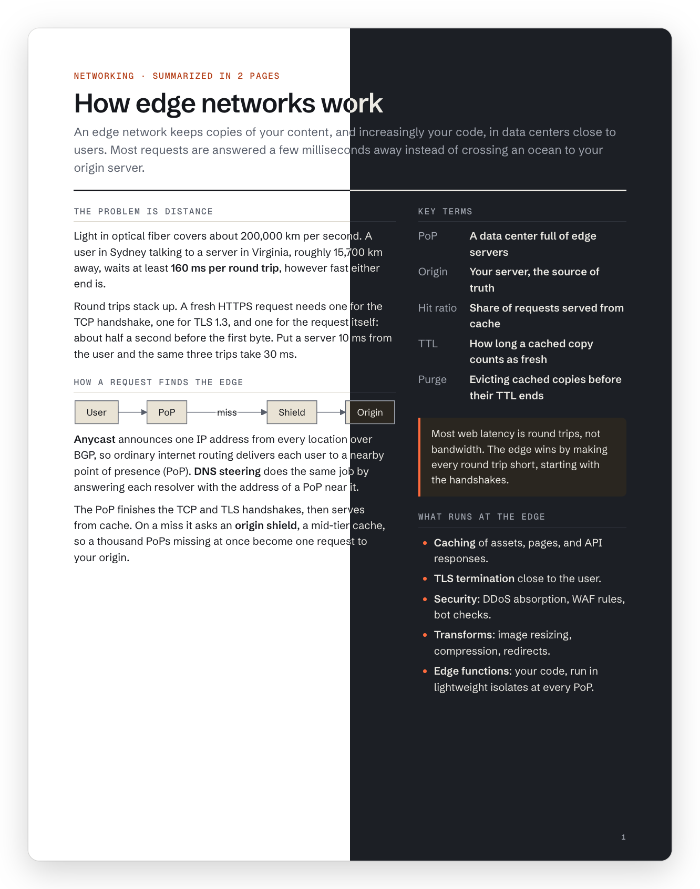

# summarize-in

An [Agent Skill](https://agentskills.io/specification) that summarizes anything into a fixed
number of printed pages: a topic, a file, a URL, a codebase, or the conversation you just
had. You get one standalone HTML file that opens anywhere, drops cleanly into Slack or
email, has a light/dark toggle on screen, and prints to exactly the page budget.

It works with any agent that supports skills, including Claude Code, Codex, GitHub
Copilot, Gemini CLI, Cursor, and OpenCode.

<p align="center">
  
</p>

```text
/summarize-in 2 pages how edge networks function
/summarize-in 1 page the research we've done in the chat
/summarize-in a 1 page cheatsheet for using this skill
/summarize-in 1 landscape page TLS handshake
```

Examples: [2-page summary](skills/summarize-in/assets/examples/demo.html) ·
[1 landscape page](skills/summarize-in/assets/examples/landscape.html) ·
[every block](skills/summarize-in/assets/examples/blocks.html)

## Install

**Any harness, one command** (uses the [`skills`](https://www.npmjs.com/package/skills) CLI):

```bash
npx skills add chalharb/one-pager -g
```

**Or clone and link** (edits to the clone go live straight away):

```bash
git clone https://github.com/chalharb/one-pager.git && cd one-pager
tools/install.sh                                   # ~/.agents/skills (Codex, Copilot, and others)
tools/install.sh --harness claude --harness agents # add Claude Code
tools/install.sh --harness all                     # every harness listed below
tools/install.sh --scope project --project-dir ~/code/app --harness claude  # one project only
```

Add `--dry-run` to see what would be linked, or `--copy` to copy instead of symlinking.
Start a new agent session afterwards, because skills load at startup.

**Requirements:**

- **Node.js 18+**
- **Chrome, Chromium, or Edge**, for Mermaid diagrams and the page-count check
- **Network access once**, to cache a pinned, checksum-verified Mermaid build

## Use

Name the skill and give it a constraint and a topic. You can also just ask for "a
one-pager on …" and the agent will pick the skill from its description.

| Harness | Invoke |
| --- | --- |
| Claude Code, Copilot CLI | `/summarize-in 2 pages <topic>` |
| Codex | `$summarize-in 2 pages <topic>` |
| Others | "summarize-in 2 pages …", or describe what you want |

**The constraint:**

| You write | You get |
| --- | --- |
| `1 page`, `2 pages`, … | The page budget. It defaults to 1 page. The agent fills it and the checker fails anything that overflows. |
| `landscape` / `portrait` | The orientation. When you don't specify one and the content would read better wide (a flow, a timeline, a wide comparison), the agent asks you first. Landscape files open the print dialog in landscape. |
| `A4` | A4 paper instead of Letter. |
| `cheatsheet`, `brief`, `overview` | Changes the content: dense lists, tables, and code for a cheatsheet, prose for a brief or overview. |

**Where files go:** inside a git repo, summaries are written to
`<repo-root>/.summarize-in/<topic>.html`, even when you run from a subdirectory.
Outside a repo they go to `~/.summarize-in/`. Set `SUMMARIZE_IN_DIR` to choose another
folder. When the summary is ready, the agent asks whether to open it in your default
browser or in your editor's preview.

**Printing:** each page is its own sheet in the HTML, so the screen view matches the
paper. Print always uses the light theme, and the theme toggle never prints.

## Blocks

Summaries are put together from small HTML blocks in
[`skills/summarize-in/assets/blocks/`](skills/summarize-in/assets/blocks/README.md):

| Block | Use it for |
| --- | --- |
| `wrapper` | The document shell: theme, page sheets, footer, print rules, light/dark toggle |
| `column-1`, `column-2` | Full-width stack; two columns (`wide-left`, `wide-right`, or `even`) |
| `title`, `subtitle` | Kicker, headline, and lede; section labels |
| `code` | Syntax highlighting done at build time, for 25+ languages, with no JavaScript in the output |
| `mermaid` | Diagrams rendered to inline SVG that follow the theme |
| `callout` | `note`, `info`, `tip`, `warn`, or `danger` |

Each block's CSS is scoped to its own `.si-<name>` class and uses only shared theme
tokens. When the agent needs something new, such as stat tiles or a timeline, it
scaffolds a **custom block** in `.summarize-in/blocks/`, either in the repo or in your
home folder. Custom blocks sit next to your summaries and override built-ins with the
same name:

```bash
node skills/summarize-in/scripts/new-block.mjs stat --use "Two to four headline numbers"
```

## How it works

```text
where.mjs     picks the output path and lists the custom-block folders
   ↓          the agent writes pages from blocks
build.mjs     inlines only the CSS of blocks used, plus fonts, highlighting, and diagrams
   ↓
check.mjs     checks the file is standalone, then measures each page in headless Chrome
   ↓          (fill %, overflow in px, diagram scale, code wrapping, PDF page count)
open.mjs      opens the file in the browser, once you say yes
```

The output has no scripts, no external requests, and no shared stylesheet. The demo
above is a single 127 KB file.

## Repository layout

```text
skills/summarize-in/      the skill (this is what gets installed)
├── SKILL.md              instructions the agent loads
├── assets/blocks/        built-in blocks + README
├── assets/examples/      demo, landscape, and block gallery (built output)
├── assets/fonts/         Schibsted Grotesk + Geist Mono (SIL OFL 1.1)
├── scripts/              where / build / check / open / new-block (Node, no dependencies)
└── evals/                eval prompts and trigger queries
tools/                    install.sh, validate.py, new_skill.py
templates/skill/          scaffold for new skills
AUTHORING.md              skill-writing guide and review checklist
```

## Develop

```bash
node skills/summarize-in/scripts/build.mjs skills/summarize-in/assets/examples/demo.html
node skills/summarize-in/scripts/check.mjs skills/summarize-in/assets/examples/demo.html --pdf /tmp/demo.pdf
python3 tools/validate.py skills --strict        # spec + portability lint
python3 tools/new_skill.py my-skill --description "Use this skill when …"
```

Keep skills harness-agnostic:

- Use only spec frontmatter fields.
- Write plain verbs ("run", "read") instead of naming a harness's tools.
- Make paths relative to the skill root.
- Make scripts non-interactive.

See [AUTHORING.md](AUTHORING.md) for the full checklist. Skill folder locations per
harness:

| Harness | Project | User |
| --- | --- | --- |
| Cross-tool convention | `.agents/skills/` | `~/.agents/skills/` |
| Claude Code | `.claude/skills/` | `~/.claude/skills/` |
| OpenAI Codex | `.agents/skills/` | `$CODEX_HOME/skills/` |
| GitHub Copilot | `.github/skills/` | `~/.copilot/skills/` |
| Gemini CLI | `.gemini/skills/` | `~/.gemini/skills/` |
| Cursor | `.cursor/skills/` | `~/.cursor/skills/` |
| OpenCode | `.opencode/skills/` | `~/.config/opencode/skills/` |

These locations change as tools evolve. If yours differs, edit the tables in
`tools/install.sh`.
