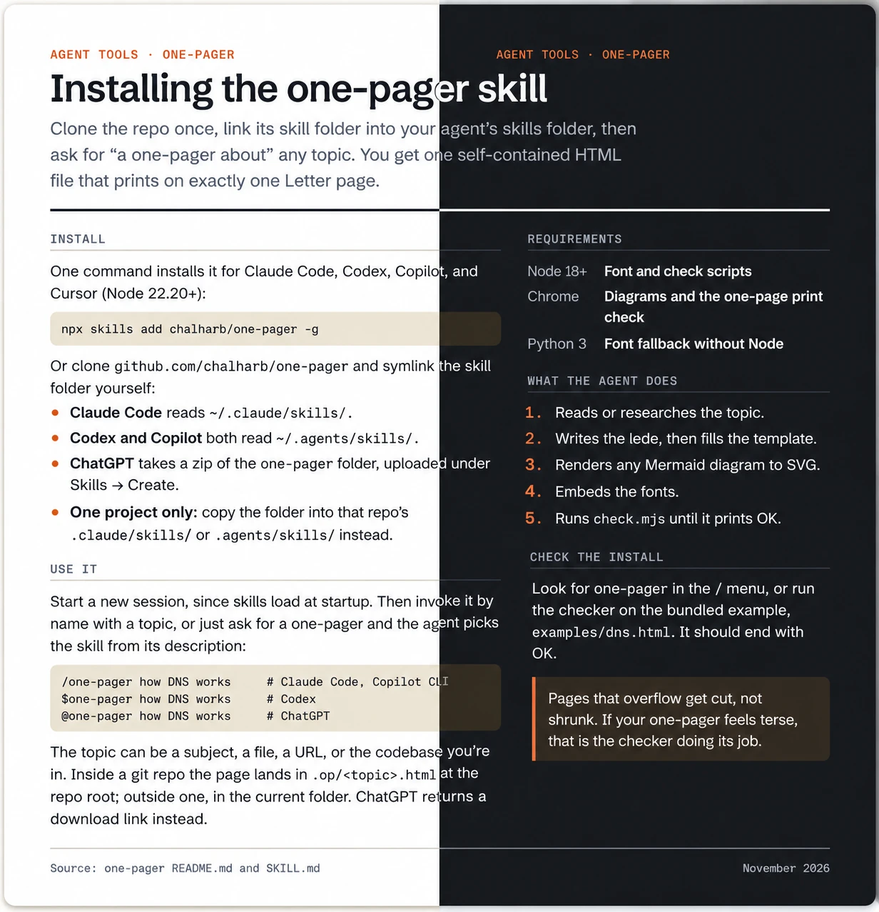

# one-pager

Two [Agent Skills](https://agentskills.io) that turn any topic into a single
self-contained HTML file that reads well on screen and prints to an exact page
count. Both use the Blueprint palette and fonts from loganharber.com.

| Skill | Makes | Example |
|---|---|---|
| `one-pager` | Exactly one Letter page: an explainer, or a cheat sheet of links and contacts | [`dns.html`](.agents/skills/one-pager/examples/dns.html), [`directory.html`](.agents/skills/one-pager/examples/directory.html) |
| `summarize-in` | Exactly 2–4 pages, with room for data charts and larger diagrams | [`edge-networks.html`](.agents/skills/summarize-in/examples/edge-networks.html) |

They work in Claude Code, OpenAI Codex, GitHub Copilot, and ChatGPT: all four
read the same `SKILL.md` format, so there is one copy of each skill.

```
/one-pager how DNS works                              # Claude Code, Copilot CLI
/summarize-in 2 pages how edge networks function
$one-pager how DNS works                              # Codex
@one-pager how DNS works                              # ChatGPT
```

Or just ask for "a one-pager about how DNS works" or "a three-page summary of
our incident process"; every tool picks the right skill from its description.

Inside a git repo the page is written to `.op/<topic>.html` at the repo root;
outside one it goes in the current directory.

Pages that are mostly things to look up, such as links to repos, Terraform
workspaces, SharePoint sites, and the people to contact, use a directory layout.
Ask for "a cheat sheet of our team's repos and contacts".

## Preview



Every page follows the reader's system theme on screen, light or dark, as in the
split above. Printing always uses the light palette, so a printout looks the same
whatever mode the screen is in.

## Requirements

- Node.js 18 or later, for the font and check scripts. Without Node, the skill
  embeds fonts with Python 3 instead and skips the automated checks.
- Google Chrome, Chromium, or Edge, for the page-count check and for diagrams.
  Without one, the page-count check is skipped and the other checks still run;
  charts need only Node. Set `CHROME_BIN` if your browser is somewhere unusual.

## Install

### Quick install (Claude Code, Codex, Copilot, Cursor)

With Node.js 22.20 or later, the open [skills CLI](https://github.com/vercel-labs/skills)
installs straight from this repo:

```bash
npx skills add chalharb/one-pager -g
```

It asks which skills and agents to install. To skip the prompts, name them;
`--skill '*'` takes both skills:

```bash
npx skills add chalharb/one-pager -g --skill '*' -a claude-code codex github-copilot -y
```

```bash
npx skills add chalharb/one-pager -g --skill summarize-in   # just one of them
```

Each skill folder is self-contained, so either works on its own. `-g` installs
for your user, so the skills work in every project. Leave it off to install
into the current project instead. Update later with
`npx skills update`, and pin a release with `chalharb/one-pager@v1.0.0`.

The skills CLI doesn't cover ChatGPT; use the zip below for that.

### Manual install

Clone the repo once:

```bash
git clone https://github.com/chalharb/one-pager.git ~/Code/one-pager
```

The skills live in `.agents/skills/one-pager/` and `.agents/skills/summarize-in/`.
The installs below symlink them, so a `git pull` in the clone updates every tool
at once. Each command shows `one-pager`; repeat it with `summarize-in` for the
second skill.

### Claude Code

```bash
mkdir -p ~/.claude/skills
```

```bash
ln -s ~/Code/one-pager/.agents/skills/one-pager ~/.claude/skills/one-pager
```

### Codex and GitHub Copilot

Both read personal skills from `~/.agents/skills`, so one link covers both:

```bash
mkdir -p ~/.agents/skills
```

```bash
ln -s ~/Code/one-pager/.agents/skills/one-pager ~/.agents/skills/one-pager
```

Copilot reads personal skills in the Copilot CLI and the cloud coding agent.
VS Code agent mode has been rolling out support; if the skill doesn't show up
there, install it into the project instead (below).

### ChatGPT

ChatGPT takes skills as an uploaded zip. Skills are a beta there, so a workspace
owner may need to turn them on first.

```bash
cd ~/Code/one-pager/.agents/skills && zip -rq ~/Downloads/one-pager.zip one-pager -x '*.DS_Store'
```

Then in ChatGPT go to **Skills → Create → Upload from your computer** and pick
`~/Downloads/one-pager.zip`. ChatGPT runs the skill in its own sandbox, so the
page comes back as a download link rather than a file in your repo.

### For one project only

To share the skill with everyone working in a repo, copy it into that repo
instead of your home folder. Use the folder for your tool:

| Tool | Project folder |
|---|---|
| Claude Code | `.claude/skills/` |
| Codex | `.agents/skills/` |
| Copilot | `.agents/skills/`, `.github/skills/`, or `.claude/skills/` |

```bash
mkdir -p .agents/skills
```

```bash
cp -R ~/Code/one-pager/.agents/skills/one-pager .agents/skills/
```

`.agents/skills/` covers Codex and Copilot. For Claude Code as well, copy it to
`.claude/skills/` too, or symlink it the way this repo does. Copies don't pick
up updates; copy again to refresh.

### Check it worked

Start a new session in your tool (skills load at startup) and look for
`one-pager` and `summarize-in` in its skill list: `/` in Claude Code, `/skills` in Codex,
`copilot skill list` in Copilot CLI. Or run the checker on the bundled example:

```bash
node ~/Code/one-pager/.agents/skills/one-pager/check.mjs ~/Code/one-pager/.agents/skills/one-pager/examples/dns.html
```

It should end with `OK`.

## Uninstall

Remove the links (this leaves the clone alone; repeat for `summarize-in`):

```bash
rm ~/.claude/skills/one-pager
```

```bash
rm ~/.agents/skills/one-pager
```

In ChatGPT, delete the skill from the Skills page. For a project copy, delete
the skill folder in that project.

## What's in a skill

Each skill folder has the same files, so it works when installed alone:

| File | Purpose |
|---|---|
| `SKILL.md` | Instructions the agent follows when the skill runs |
| `template.html` | Page frame with every style, light, dark, and print |
| `snippets/` | Shells (explainer, directory, report) and blocks (link list, contacts, chart, comparison, timeline…), one file each, with an `INDEX.md` of when to use what |
| `chart.mjs` | Renders bar and line charts from a small JSON spec to inline SVG in the palette (Node only) |
| `diagram.mjs` | Renders Mermaid diagrams to inline SVG in the palette (needs Chrome; downloads Mermaid once to `~/.cache/one-pager/`) |
| `fonts.mjs`, `fonts.py` | Embed the fonts into a finished page as base64 (Python for sandboxes without Node) |
| `check.mjs` | Fails a page that loads from the network, has leftover placeholders, strays from the palette, or prints to the wrong page count |
| `chrome.mjs` | Finds Chrome for the checker and the diagram renderer |
| `fonts/` | Schibsted Grotesk and Geist Mono (latin subset) |
| `examples/` | Finished pages |

`.claude/skills/` in this repo holds symlinks to `.agents/skills/`, so Claude
Code, Codex, and Copilot all find both skills when you work in this repo. On
Windows, enable symlinks in Git (`git config core.symlinks true`) or the links
check out as plain text files.

## Editing the skills

Everything except `SKILL.md`, `template.html`, and `examples/` is shared. The
single source is `shared/`; `scripts/sync.mjs` copies it into every skill and
writes `shared/style.css` into each template and example.

Each snippet in `shared/snippets/shells/` and `shared/snippets/blocks/` starts
with a header comment (`name`, `use`, `fits`, and optionally `limit` and
`notes`). The sync builds `snippets/INDEX.md` from those headers plus the
hand-written `shared/snippets/choosing.md`, so to add a block you add one file:

```bash
node scripts/sync.mjs          # after editing anything in shared/ (rebuilds INDEX.md)
node scripts/sync.mjs --check  # what CI runs: fails if a copy is out of date
```

Never edit the copies in `.agents/skills/<skill>/`; the next sync overwrites
them. CI also runs the checker on every example.

## Fonts

Schibsted Grotesk and Geist Mono are licensed under the SIL Open Font License
1.1, which allows bundling and redistribution. The license texts ship with the
fonts in [`fonts/`](.agents/skills/one-pager/fonts/).
